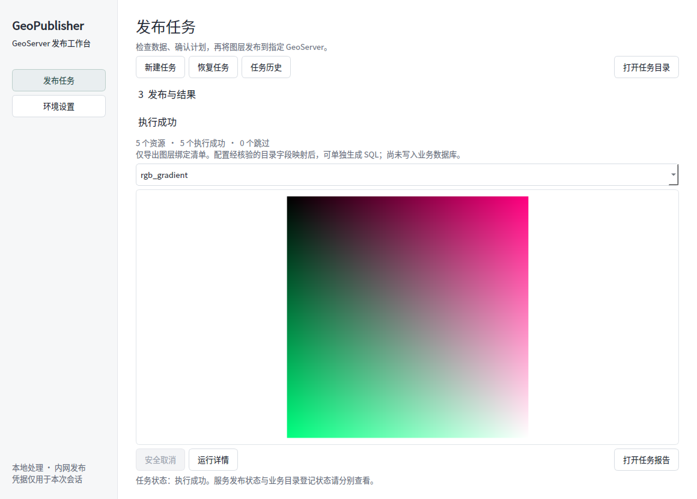

# GeoPublisher Workbench

面向实施人员的 GeoServer 自动发布工作台。Python 核心同时驱动 CLI 和中文 PySide6 桌面界面：本地预检 → 冻结发布计划 → REST 发布 → WMS 实图验收 → 任务报告与目录绑定清单。

**当前版本：0.1.0 开发预览。** 已在隔离的 GeoServer 2.24.4 和 GDAL 3.13.3 上完成合成数据发布、重复执行、配置清理及上传响应丢失验证。Windows 完整 GDAL 运行时与现场环境仍需原生验收；当前构建不等于可直接交付内网的离线安装包。



## 已实现

| 能力 | 当前行为 |
|---|---|
| 数据输入 | 单个或批量 SHP、独立 GeoTIFF；源文件保持不变 |
| 本地预检 | SHP 组件、编码、CRS、字段、范围；TIFF CRS、波段和外部依赖；首版发布要求可验证的 EPSG；明确指定受控 GDAL |
| 样式 | 默认点/线/面/栅格 SLD，或最多 5 MiB 的已有 SLD；检查字段引用并拒绝外部资源 |
| 发布策略 | 同名停止、明确跳过、任务固定名称的新版本；不提供原位替换 |
| 服务验收 | WMS PNG 解码、尺寸、透明度和内容检查；矢量可选 WFS 抽样；无法判断的图片标记待人工核验 |
| 任务恢复 | SQLite 持久化写意图、结果、所有权快照和锁；未知写结果不盲目重试 |
| 配置清理 | 精确清理本任务拥有且未被外部修改的对象；保留服务器实际数据文件 |
| 目录接入 | 导出绑定清单；人工核验字段映射后生成 PostgreSQL SQL；不连接业务数据库 |
| 桌面界面 | 数据选择、环境设置、预检、一次任务级确认、后台执行、检查点取消、真实地图、历史及恢复 |

尚不支持 QML/ArcGIS 样式转换、ImageMosaic/ImagePyramid、数据原位更新、自动写业务库、完整几何质检、大文件分片续传。完整范围见 [v0.2 开发基线](docs/PRD-v0.2.md) 和 [开发路线](docs/ROADMAP.md)。

## Windows 开发环境

准备 Git、Python 3.12、uv 0.13.4 和 Pixi。首次安装依赖需要联网；受限内网的运行时须提前准备。

以下命令在 PowerShell 中执行，项目放在 D 盘：

```powershell
git clone https://github.com/kllin8154-arch/GeoPublisher-Workbench.git D:\Java-p\GeoPublisher-Workbench
Set-Location D:\Java-p\GeoPublisher-Workbench
uv sync --frozen --extra desktop --extra dev --extra packaging
pixi install --locked
uv run --frozen --no-sync geopub-desktop
```

环境设置中的 GDAL 目录填：

```text
D:/Java-p/GeoPublisher-Workbench/.pixi/envs/default/Library/bin
```

预期版本填 `3.13.3`。必须使用包含 GDAL、PROJ、所需 DLL 和数据目录的完整运行时，不能只复制几个 EXE。Windows 原生验证状态见 [验证记录](docs/VALIDATION.md)。

应用默认任务目录在存在 D 盘时为 `D:/a系统测试/GeoPublisher-Workbench`，也可自行选择。环境档案和任务产物应保存在本机 `data/` 或其他明确的数据目录，避免提交到 Git。

桌面版的首次连接、凭据输入、任务恢复和结果说明见 [桌面使用说明](docs/DESKTOP.md)。

## Linux 开发环境

```bash
uv sync --frozen --extra desktop --extra dev --extra packaging
pixi install --locked
uv run --frozen --no-sync geopub --version
uv run --frozen --no-sync geopub-desktop
```

Linux GDAL 目录为 `.pixi/envs/default/bin` 的绝对路径。图形界面需系统 Qt 所需库和中文字体；无图形会话可运行 CLI。`pixi.lock` 分别锁定 `linux-64` 与 `win-64` 依赖；Python 应用依赖由 `uv.lock` 锁定。

## CLI 发布流程

将 `examples/environment.example.json` 复制为本机环境档案。示例为回环测试地址，需设置实际授权的 GeoServer 根地址、**已存在**的工作空间、GDAL 路径和必要的 CA 文件。相对文件路径以环境档案所在目录为基准；Windows 请使用上面的 `Library/bin` 布局。

凭据通过当前会话的 `GEOPUB_USERNAME`、`GEOPUB_PASSWORD` 环境变量传入，或在桌面界面临时输入。环境 JSON 只保存变量名引用，不写明文凭据。HTTPS 默认校验证书；使用授权内网 HTTP 时必须显式设定 `allow_http: true`。

```bash
# 本地运行时检查，不连接服务器
uv run --frozen --no-sync geopub doctor --environment data/environment.json --offline

# 生成数学合成样本，仅用于开发验证；输出目录必须为空
uv run --frozen --no-sync python scripts/generate_samples.py --gdal-bin .pixi/envs/default/bin --output data/synthetic

# 离线预检：任务输出目录必须尚不存在
uv run --frozen --no-sync geopub plan data/synthetic --environment data/environment.json --output data/runs/demo-001 --strategy new-version --wfs

# 阅读预检结果、plan.json 和目标清单，交互输入 PUBLISH 后执行
uv run --frozen --no-sync geopub run data/runs/demo-001/plan.json

# 查看与桌面版共享的任务记录
uv run --frozen --no-sync geopub status --journal data/runs/geopublisher.sqlite
```

Windows 生成样本时将 `--gdal-bin` 改为 `.pixi/envs/default/Library/bin`。批处理可在人工审核后使用 `run ... --yes`；它表示明确授权计划中的写操作，不是忽略预检问题。

成功任务产生 `report.json`、`report.md`、`catalog-bindings.json` 和实际 WMS PNG。WMS 验收成功与业务目录登记分别记录。`SKIPPED` 不表示本次源数据已生效，`REVIEW_REQUIRED` 需要检查图像，`MANUAL_ACTION_REQUIRED` 需要核对服务器和任务记录。

### 恢复与清理

恢复使用原来的 `plan.json` 和任务数据库，再次执行同一 `run` 命令。计划内目标名称和文件摘要保持固定，不要手工改写计划或删除任务库后重试。首次已知成功的写操作不会重复执行；服务端状态不确定或出现外部修改时转人工核对。

仅当确实要撤下本任务服务配置时执行：

```bash
uv run --frozen --no-sync geopub cleanup data/runs/demo-001/plan.json
```

交互输入 `CLEANUP` 后，程序先检查全部对象的所有权与当前指纹，再执行精确清理。清理保留 GeoServer 中实际数据文件，不等于数据备份恢复。已经清理的任务不能原样再次发布，应新建计划。

### 目录 SQL

参照 [目录适配说明](docs/CATALOG.md) 人工核验现场表结构、唯一键和关系，再生成 SQL：

```bash
uv run --frozen --no-sync geopub catalog data/runs/demo-001/catalog-bindings.json --mapping data/reviewed-catalog-mapping.json --output data/catalog/demo-001
```

示例映射使用虚构表名，核验标志默认关闭，不能直接用于现场。生成器不会执行 SQL；`rollback.sql` 仅用于人工核对，不包含未经执行回执支持的自动删除。

## 开发与验证

```bash
uv run --frozen --no-sync ruff check .
uv run --frozen --no-sync pytest -q
uv run --frozen --no-sync python -m build --no-isolation
```

无图形会话运行测试时设 `QT_QPA_PLATFORM=offscreen`。真实 GeoServer 集成检查单独执行，仅接受一次性的回环测试服务：

```bash
uv run --frozen --no-sync python scripts/integration_check.py --environment data/test-environment.json --samples data/synthetic --output data/integration/new-run
```

此脚本会创建测试工作空间及服务对象，验证发布、重复执行、清理和上传响应丢失。响应丢失场景会保留未自动认领的测试存储，符合实际保护逻辑；测试结束后销毁整个一次性测试服务即可。不要指向承担业务的 GeoServer。

GitHub Actions 配置了 Linux/Windows 单元测试、wheel 构建和 Windows PyInstaller 桌面预览。**预览产物不包含受控 GDAL，不是完整离线包。** 平台执行证据与已知限制见 [验证记录](docs/VALIDATION.md)。

## 代码结构

| 模块 | 职责 |
|---|---|
| `config.py` / `plans.py` | 环境、输入类型、不可变计划、来源与产物摘要 |
| `datasets.py` / `styles.py` | 受控 GDAL、数据预检、打包与 SLD |
| `geoserver.py` / `verification.py` | REST、WMS/WFS、图像验收 |
| `journal.py` / `engine.py` | 写意图、锁、所有权、恢复与精确清理 |
| `catalog.py` | 已核验字段映射和 SQL 导出 |
| `cli.py` / `desktop.py` | 共享核心的命令行与桌面入口 |

开发约束见 [AGENTS.md](AGENTS.md) 和 [执行边界](SECURITY.md)。仓库只接收代码、说明和合成样本生成器，不接收真实空间数据、现场环境档案或凭据。
