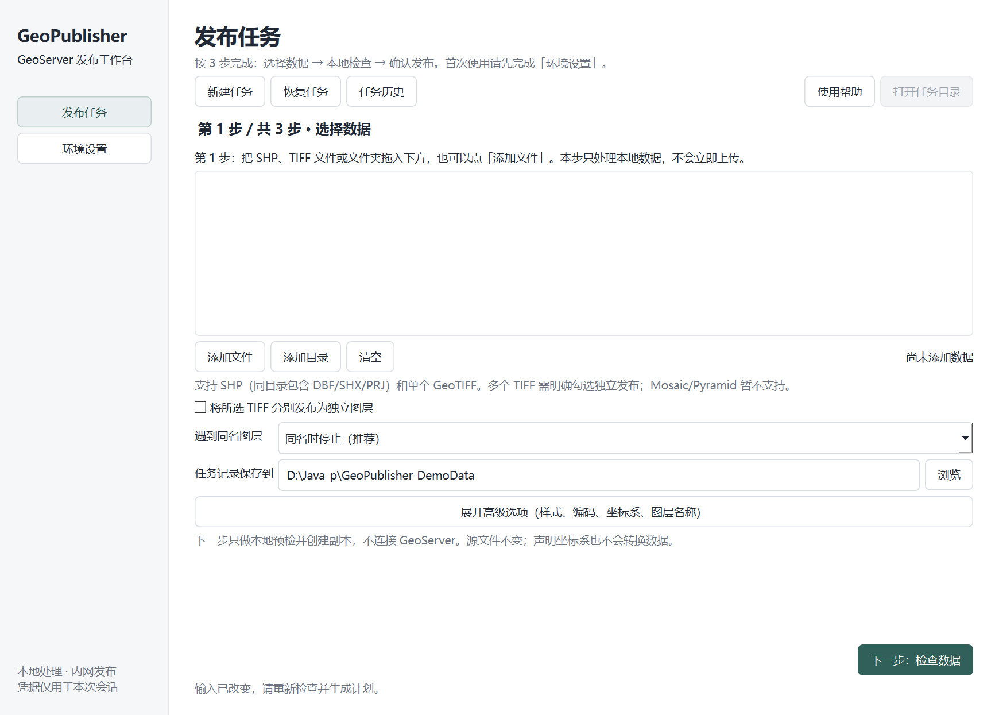

# GeoPublisher Workbench

面向实施人员的 GeoServer 自动发布工作台。Python 核心同时驱动 CLI 和中文 PySide6 桌面界面：本地预检 → 冻结发布计划 → REST 发布 → WMS 实图验收 → 任务报告与目录绑定清单。

**第一次使用？先看 [三步上手指南](docs/QUICKSTART-ZH.md)**：环境设置和只读连接检查 → 拖入 SHP/TIFF 并本地预检 → 确认发布、查看地图与报告。若来源是 GDB、MXD 或 LYR，请先阅读 [离线转换与字段映射指南](docs/IMPORT-GDB-MXD-LYR.md)：GDB 可用受控 GDAL 转 SHP，MXD/LYR 则需要相应的 ArcMap/QGIS 适配工具。

**当前版本：0.1.0 开发预览。** 已在 Windows 10 和 Linux 的隔离环境中，使用 GeoServer 2.24.4、GDAL 3.13.3 与合成数据完成核心发布、重复执行、配置清理及上传响应丢失验证。Windows 原生桌面启动与字体烟测、受控 GDAL 已取得本地证据；完整 Windows/Linux 离线发行物与现场环境仍需验收，当前构建不等于可直接交付内网的离线安装包。详见 [验证汇总](docs/VALIDATION.md) 和 [Windows 本地验证报告](docs/VALIDATION-WINDOWS-2026-11-01.md)。

PR #1 的凭据隔离补丁已通过 Windows 增量验证（`332 passed, 4 skipped`）：原生 GDAL 用例实际执行，中文路径预检和桌面后台生成计划通过，GDAL 子进程不再继承默认或档案自定义的发布凭据，父进程凭据读取正常。原版 `310 passed, 4 skipped` 的证据仍单独保留，详见 [补丁验证记录](docs/VALIDATION-WINDOWS-2026-11-01.md#7-pr-1-凭据隔离补丁的-windows-增量验证)。

PR #2 的多 TIFF 导入意图与已知结构阻断已通过 Windows 原生增量验收：`409 passed, 5 skipped`，跳过项均为符号链接权限测试；原生 GDAL、中文及空格路径、桌面勾选确认和后台计划通过。Linux 本地 `414 passed`；[Actions #8](https://github.com/kllin8154-arch/GeoPublisher-Workbench/actions/runs/41286109109) 两平台均 `413 passed, 1 skipped`，唯一跳过为 CI 未安装的原生 GDAL，构建与产物上传成功。详见 [本次验证](docs/VALIDATION-WINDOWS-2026-11-01.md#8-pr-2-多-tiff-导入的-windows-增量验证)。Windows 桌面预览仍不包含完整 GDAL/PROJ 离线运行时。



## 已实现

| 能力 | 当前行为 |
|---|---|
| 数据输入 | 单个或批量 SHP、独立 GeoTIFF；多个 TIFF 需要明确确认分别发布，已知 Mosaic/Pyramid 结构及辅助索引阻断；源文件保持不变 |
| 本地格式转换 | **GDB→SHP**：只读预检、按要素类选择、稳定的 DBF 短字段名、CSV 字段对照、失败残留隔离；**MXD**：导出 ArcMap 10.x 本地辅助脚本及真实合成 MXD 生成脚本；**LYR**：支持 QGIS+SLYR 离线 QML/SLD 转换；**桌面直接操作**：可直接选择 MXD 或 LYR 目录，后台转换、进度、取消、报告与人工确认后加入发布选择 |
| 本地预检 | SHP 组件、编码、CRS、字段、范围；TIFF CRS、波段和外部依赖；首版发布要求可验证的 EPSG；明确指定受控 GDAL |
| 样式 | 默认点/线/面/栅格 SLD，或最多 5 MiB 的已有 SLD；检查字段引用并拒绝外部资源；GDB 转 SHP 的短字段名可在用户显式确认、转换报告与配套 SHP 哈希一致后仅修复简单 SLD 字段引用 |
| 发布策略 | 同名停止、明确跳过、任务固定名称的新版本；不提供原位替换 |
| 服务验收 | WMS PNG 解码、尺寸、透明度和内容检查；矢量可选 WFS 抽样；无法判断的图片标记待人工核验 |
| 任务恢复 | SQLite 持久化写意图、结果、所有权快照和锁；未知写结果不盲目重试 |
| 配置清理 | 精确清理本任务拥有且未被外部修改的对象；保留服务器实际数据文件 |
| 目录接入 | 导出绑定清单；人工核验字段映射后生成 PostgreSQL SQL；不连接业务数据库 |
| 桌面界面 | 数据选择、环境设置、预检、一次任务级确认、后台执行、检查点取消、真实地图、历史及恢复；ArcMap/QGIS 本机直接转换向导 |

已在隔离 GeoServer 2.24.4 上以**纯数学合成多边形**完成 GDB→SHP→短字段映射→SLD 的真实只读 WMS 颜色验证；见 [分类样式实测](docs/VALIDATION-SLD-CLASSIFICATION-2026-11-02.md)。此测试采用停机准备的专用 catalog，不代表正式 REST 发布或真实 LYR/MXD 视觉保真。另已在 ArcMap 10.8 / QGIS 4.2.1 上完成真实合成 MXD→SHP/LYR→QML/SLD 离线转换及中文路径检查；详见 [本机验收](docs/VALIDATION-ARCMAP-QGIS-2026-11-02.md)。当前不能在工作台内直接解析 MXD/LYR 二进制文件，真实 ArcMap/QGIS 样式转换须在具备软件及授权的离线环境完成。尚不支持 ImageMosaic/ImagePyramid、数据原位更新、自动写业务库、完整几何质检、大文件分片续传。完整范围见 [v0.2 开发基线](docs/PRD-v0.2.md) 和 [开发路线](docs/ROADMAP.md)。

桌面端现已提供**直接转换 MXD / LYR**：选择来源、核对本地 ArcMap/QGIS Python、后台处理并检查结果；转换成功后由用户决定是否将 SHP/SLD 加入发布计划。此过程不涉及生产服务器或数据上传，ArcMap/QGIS/SLYR 等仍须用户在本机合法安装；见 [直接转换说明](docs/DESKTOP.md#在桌面界面直接转换-mxd--lyr无需手动运行命令) 与 [本机验收](docs/VALIDATION-DIRECT-MXD-LYR-2026-11-02.md)。

## Windows 开发环境

准备 Git、Python 3.12、uv 0.13.4 和 Pixi。首次安装依赖需要联网；受限内网的运行时须提前准备。

以下命令在 PowerShell 中执行，项目放在 D 盘：

```powershell
git clone https://github.com/kllin8154-arch/GeoPublisher-Workbench.git D:\Java-p\GeoPublisher-Workbench
Set-Location D:\Java-p\GeoPublisher-Workbench
uv sync --frozen --extra desktop --extra dev --extra packaging
pixi install --locked
uv run --frozen --no-sync geopub-desktop
```

环境设置中的 GDAL 目录填：

```text
D:/Java-p/GeoPublisher-Workbench/.pixi/envs/default/Library/bin
```

预期版本填 `3.13.3`。必须使用包含 GDAL、PROJ、所需 DLL 和数据目录的完整运行时，不能只复制几个 EXE。Windows 原生验证状态见 [验证汇总](docs/VALIDATION.md) 和 [2026-11-01 详细报告](docs/VALIDATION-WINDOWS-2026-11-01.md)。

应用默认任务目录在存在 D 盘时为 `D:/a系统测试/GeoPublisher-Workbench`，也可自行选择。环境档案和任务产物应保存在本机 `data/` 或其他明确的数据目录，避免提交到 Git。

桌面版的首次连接、凭据输入、任务恢复和结果说明见 [桌面使用说明](docs/DESKTOP.md)。

## Linux 开发环境

```bash
uv sync --frozen --extra desktop --extra dev --extra packaging
pixi install --locked
uv run --frozen --no-sync geopub --version
uv run --frozen --no-sync geopub-desktop
```

Linux GDAL 目录为 `.pixi/envs/default/bin` 的绝对路径。图形界面需系统 Qt 所需库和中文字体；无图形会话可运行 CLI。`pixi.lock` 分别锁定 `linux-64` 与 `win-64` 依赖；Python 应用依赖由 `uv.lock` 锁定。

## CLI 发布流程

将 `examples/environment.example.json` 复制为本机环境档案。示例为回环测试地址，需设置实际授权的 GeoServer 根地址、**已存在**的工作空间、GDAL 路径和必要的 CA 文件。相对文件路径以环境档案所在目录为基准；Windows 请使用上面的 `Library/bin` 布局。

凭据通过当前会话的 `GEOPUB_USERNAME`、`GEOPUB_PASSWORD` 环境变量传入，或在桌面界面临时输入。环境 JSON 只保存变量名引用，不写明文凭据。HTTPS 默认校验证书；使用授权内网 HTTP 时必须显式设定 `allow_http: true`。

```bash
# 本地运行时检查，不连接服务器
uv run --frozen --no-sync geopub doctor --environment data/environment.json --offline

# 生成数学合成样本，仅用于开发验证；输出目录必须为空
uv run --frozen --no-sync python scripts/generate_samples.py --gdal-bin .pixi/envs/default/bin --output data/synthetic

# 离线预检：任务输出目录必须尚不存在
uv run --frozen --no-sync geopub plan data/synthetic --environment data/environment.json --output data/runs/demo-001 --strategy new-version --wfs

# 阅读预检结果、plan.json 和目标清单，交互输入 PUBLISH 后执行
uv run --frozen --no-sync geopub run data/runs/demo-001/plan.json

# 查看与桌面版共享的任务记录
uv run --frozen --no-sync geopub status --journal data/runs/geopublisher.sqlite
```

Windows 生成样本时将 `--gdal-bin` 改为 `.pixi/envs/default/Library/bin`。批处理可在人工审核后使用 `run ... --yes`；它表示明确授权计划中的写操作，不是忽略预检问题。

多个 TIFF 需要明确增加 `plan ... --raster-mode independent`，或在桌面勾选“将所选 TIFF 分别发布为独立图层”。该选项不能绕过 Mosaic/Pyramid 结构标记。任务目录必须在所选输入目录之外；导入来源、方式和数量随新计划冻结，执行前变化会要求重新预检。检测边界、旧计划兼容与增量验收见 [多 TIFF 导入说明](docs/RASTER-IMPORTS.md)。

成功任务产生 `report.json`、`report.md`、`catalog-bindings.json` 和实际 WMS PNG。WMS 验收成功与业务目录登记分别记录。`SKIPPED` 不表示本次源数据已生效，`REVIEW_REQUIRED` 需要检查图像，`MANUAL_ACTION_REQUIRED` 需要核对服务器和任务记录。

### 恢复与清理

恢复使用原来的 `plan.json` 和任务数据库，再次执行同一 `run` 命令。计划内目标名称和文件摘要保持固定，不要手工改写计划或删除任务库后重试。首次已知成功的写操作不会重复执行；服务端状态不确定或出现外部修改时转人工核对。

仅当确实要撤下本任务服务配置时执行：

```bash
uv run --frozen --no-sync geopub cleanup data/runs/demo-001/plan.json
```

交互输入 `CLEANUP` 后，程序先检查全部对象的所有权与当前指纹，再执行精确清理。清理保留 GeoServer 中实际数据文件，不等于数据备份恢复。已经清理的任务不能原样再次发布，应新建计划。

### 目录 SQL

参照 [目录适配说明](docs/CATALOG.md) 人工核验现场表结构、唯一键和关系，再生成 SQL：

```bash
uv run --frozen --no-sync geopub catalog data/runs/demo-001/catalog-bindings.json --mapping data/reviewed-catalog-mapping.json --output data/catalog/demo-001
```

示例映射使用虚构表名，核验标志默认关闭，不能直接用于现场。生成器不会执行 SQL；`rollback.sql` 仅用于人工核对，不包含未经执行回执支持的自动删除。

## 开发与验证

```bash
uv run --frozen --no-sync ruff check .
uv run --frozen --no-sync pytest -q
uv run --frozen --no-sync python -m build --no-isolation
```

无图形会话运行测试时设 `QT_QPA_PLATFORM=offscreen`。真实 GeoServer 集成检查单独执行，仅接受一次性的回环测试服务：

```bash
uv run --frozen --no-sync python scripts/integration_check.py --environment data/test-environment.json --samples data/synthetic --output data/integration/new-run
```

此脚本会创建测试工作空间及服务对象，验证发布、重复执行、清理和上传响应丢失。响应丢失场景会保留未自动认领的测试存储，符合实际保护逻辑；测试结束后销毁整个一次性测试服务即可。不要指向承担业务的 GeoServer。

GitHub Actions 配置了 Linux/Windows 单元测试、wheel 构建和 Windows PyInstaller 桌面预览。**CI 预览产物不包含受控 GDAL，不是完整离线包。** 在本机 D 盘另行完成了带 GDAL 3.13.3/PROJ 的 Windows 内部便携预览、原生 Qt 启动和桌面快捷方式验证，详见 [Windows 便携版安装与验证](docs/WINDOWS-PORTABLE.md)。该本地包仍待干净断网目标机及许可证/签名验收，不应当作正式发布版。平台执行证据与已知限制见 [验证记录](docs/VALIDATION.md)。

## 代码结构

| 模块 | 职责 |
|---|---|
| `config.py` / `plans.py` | 环境、输入类型、不可变计划、来源与产物摘要 |
| `imports.py` | 本地结构标记、显式多 TIFF 意图、冻结来源与执行前复核 |
| `datasets.py` / `styles.py` | 受控 GDAL、数据预检、打包与 SLD |
| `geoserver.py` / `verification.py` | REST、WMS/WFS、图像验收 |
| `journal.py` / `engine.py` | 写意图、锁、所有权、恢复与精确清理 |
| `catalog.py` | 已核验字段映射和 SQL 导出 |
| `cli.py` / `desktop.py` | 共享核心的命令行与桌面入口 |

开发约束见 [AGENTS.md](AGENTS.md) 和 [执行边界](SECURITY.md)。仓库只接收代码、说明和合成样本生成器，不接收真实空间数据、现场环境档案或凭据。


## 多级业务目录与比例尺图幅（2026-11）

原有目录 SQL 生成器用于简单的服务与图层登记。新增 **业务分类 / 比例尺 SQL** 用于多级树结构，例如“基础地质 → 1:5万基础地质图 → 某图幅”，或者“底图 → 世界影像”。它不会把所有业务图层强行放到 baseMap，也不自动更改既有父节点。

入口：桌面“发布任务 → 业务分类 / 比例尺 SQL”，或 CLI：

    uv run --frozen --no-sync geopub catalog-tree examples/business-tree.example.json --output D:\LocalGIS\catalog-tree-review-new

示例中的所有图层、表名及比例尺均为虚构测试，默认未完成 WMS 验收，因此只生成阻断版 SQL，不会得到可误执行的 INSERT。真实业务需先在已授权的数据库只读核对现有分类/服务关系，再填写实际映射，提供目标 GeoServer 的真实 WMS PNG 和人工审核结果。**生成 SQL 不意味着已执行数据库操作**。

支持的处理链路：本机 MXD→SHP/LYR、GDB→SHP、LYR→SLD、SHP/单幅 GeoTIFF 正式发布、WMS/WFS 实图验收，然后生成可审核的多级业务节点 SQL。ImageMosaic/ImagePyramid 暂保留为独立的受控服务器流程，不能通过单幅 TIFF 发布引擎伪装成镶嵌服务。

完整说明：[通用 GIS 转换、发布及业务目录 SQL 工作流](docs/BUSINESS-CATALOG-WORKFLOW.md)。


### 从已发布任务生成业务目录初稿

无需手填每个 GeoServer 图层名。桌面 **“业务分类 / 比例尺 SQL”** 选择任务文件 plan.json，会离线生成待人工分类的 business_tree_draft.json；选择已有目录 JSON 则进入 SQL 审查生成。CLI 同样支持：

    uv run --frozen --no-sync geopub catalog-draft D:\LocalGIS\task-xxx\plan.json --output D:\LocalGIS\catalog-draft-new

新初稿**不会猜测比例尺或父节点**，所有图层先放入 draft_unclassified，强制未审核，不能直接写入数据库。对已完成 WMS 的发布结果，仅预填任务内有效 PNG 的位置，仍需业务人员检查视觉、样式、真实数据来源与目录归属。完整流程见 [业务分类与比例尺工作流](docs/BUSINESS-CATALOG-WORKFLOW.md)。


## Linux 服务器实际交付（SSH/SFTP / Linux 本机，2026-11）

新增桌面 **“Linux 服务器部署”** 入口与 CLI。Windows/macOS/Linux 客户端支持通过已核验 SSH 主机公钥的 SFTP 传输受控 tar、服务器 SHA256 校验、全新目录解包；同一套 CLI 也支持 Linux 服务器本地复制与 GeoServer localhost REST。

分两条路径：

1. **图幅矢量与单影像**：MXD/GDB 先在本地转换 SHP/LYR/SLD，再由原有 plan.json、SQLite 审计引擎经 SSH localhost 隧道发布到目标 GeoServer（禁止修改不可变计划绑定的服务地址）。
2. **服务器端栅格/全球影像**：已核验的 GeoTIFF/ImageMosaic 发布包经 SFTP 落地后，使用 GeoServer REST external.geotiff / external.imagemosaic 注册，保存 WMS PNG、granules 计数和每个 REST 写入意图。

每一步独立确认，同名对象拒绝覆盖，未知结果不盲重试；SSH、GeoServer 密码均不保存。**业务目录 SQL 仍从 catalog-draft/catalog-tree 生成并经实际数据库审核后人工执行**，当前 SSH 功能不会自动写 206 PostgreSQL。真实现场必须先核实权限、GeoServer 插件、JDK 服务进程、206 的字段及父节点。

详细实施和 CLI 示例：[局域网 Linux 服务器发布指南](docs/SERVER-LAN-DEPLOY.md)。


### 206 PostgreSQL 业务目录核验（只读）

新增 **“Linux 服务器部署 → 7. 业务数据库表与父节点只读核验”**。Windows/macOS/Linux 可通过 206 专属 SSH 隧道访问 PostgreSQL localhost；Linux 本机也可使用同一接口。它对审核中的 business-tree JSON 检查服务/节点表、字段及数据类型、id 序列、真实父节点、拟新增节点和 GeoServer 服务冲突，仅输出本机证据 JSON，**不会执行 SQL、上传数据或修改数据库**，且永不自动标记 schema_verified=true。CLI：

    geopub server-catalog-doctor --profile <206 SSH配置> --catalog-json <业务目录JSON> --database <数据库名> --database-user <只读用户> --output <本机全新证据目录>

详细说明：[206 PostgreSQL 只读审查流程](docs/DATABASE-CATALOG-READONLY.md)。
