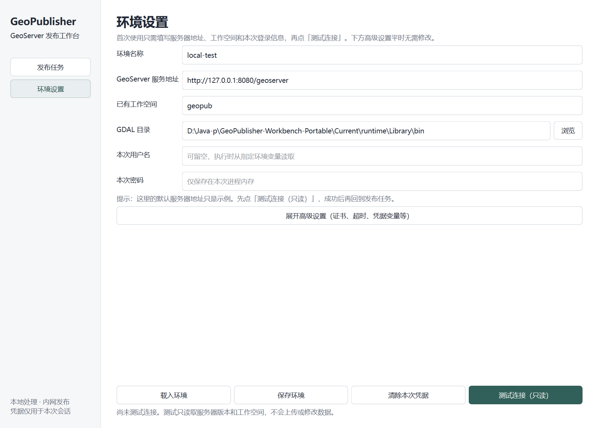

# GeoPublisher Workbench｜三步上手指南

这是一款用于把本地 SHP 和 GeoTIFF 发布到 **已授权 GeoServer** 的桌面工具。它会先做本地检查，再由你确认执行。源文件不会被覆盖；发布服务与登记业务目录是两件不同的事。

**目前为内部开发预览**：未经授权不要连接生产 GeoServer；真实项目空间数据不得上传互联网或远程服务器，只在许可的本地/隔离环境处理。

## 第一次使用：先配置服务器

在 Windows 桌面双击 **GeoPublisher Workbench**，点击左侧 **环境设置**。

先填写：
- **环境名称**：例如 `test-server`，只是用来区分不同环境的名称。
- **GeoServer 服务地址**：应为你已经获准使用的服务根地址，如 `https://your-server.example/geoserver`。界面里的 `127.0.0.1:8080` 只是示例，不代表连接成功。
- **已有工作空间**：要发布到的 Workspace；这里不会自动替你创建。
- **GDAL 目录**：完整便携预览版会自动填写。如果为空，需要选择经过验证的 GDAL 工具目录。
- **本次用户名／密码**：只保留在本次程序会话中，不写入环境档案。

点击 **测试连接（只读）**。程序只读取服务器版本与目标工作空间状态，**不会上传数据、创建图层或执行数据库 SQL**。

显示“连接成功、工作空间存在”后，便可返回发布任务。显示“工作空间不存在”时，请先联系管理员在 GeoServer 中创建；不要靠盲目重试解决。

证书、HTTP 内网许可、超时和凭据环境变量等属于**高级设置**，日常无需展开。使用非回环 HTTP 时，必须是已授权的内网环境并明确许可。

## 第 1 步：选择数据

点击 **发布任务**，把 SHP、GeoTIFF 或包含这类文件的目录拖入列表，也可以点“添加文件”或“添加目录”。

- **SHP**：请将对应 DBF、SHX、PRJ、CPG 等文件保存在同一目录；工具会做组件与编码检查。
- **GeoTIFF**：首版适用于独立单个 TIFF。多个普通 TIFF 必须明确勾选 **分别发布为独立图层**。
- **Mosaic / Pyramid**：多文件拼接和金字塔发布目前不支持；检测到已知目录特征会停止。
- **同名处理**：保持默认 **同名时停止（推荐）**。选择“跳过”不代表更新了当前文件。
- **任务记录保存到**：推荐保留在 D 盘，和原始数据目录分开。任务预检会保存独立副本、计划和审计记录。

需要自定义 SLD、特殊编码、图层名，或补充确切 CRS 时，再点 **展开高级选项**。**声明 CRS 不会自动重投影**；不要为完成发布而随意填写 EPSG。

完成后点击 **下一步：检查数据**。本阶段仅调用本地工具，不接触 GeoServer 服务器。

## 第 2 步：看检查结果、再确认

系统会列出每个图层的类型、CRS 与检查结论：

| 显示 | 如何处理 |
|---|---|
| 通过 | 核对图层名称与目标工作空间后可以继续 |
| 通过，有提示 | 仔细看提示内容；编码、样式或数据语义可能需要人工确认 |
| 阻断 | 不会执行发布；返回调整数据或设置，再重新检查 |

只有全部必要条件满足时，**确认并发布** 按钮才能使用。点击后还会弹出最后确认，明确本次服务地址、工作空间和同名策略。点击取消不会上传任何文件。

## 第 3 步：查看实际地图与结果

发布时可看到当前任务进度；详细 HTTP/诊断信息默认收在 **运行详情**，出问题时再展开。

| 最终状态 | 下一步 |
|---|---|
| 执行成功 | 查看真实 WMS 预览；如业务系统还需要目录项，应另行核对并执行 SQL |
| 需要核对地图 | 返回了可解析图片，但不能证明内容、位置或样式全部正确，请人工查看 |
| 部分完成／执行未完成 | 查看任务报告，按原因修复；已完成的资源可能保留 |
| 需要人工核对 | 服务器可能已写入但客户端没有收到结果；**不要直接重复上传或删除** |
| 已跳过 | 沿用服务器旧图层，本次输入**没有被发布** |
| 已安全取消 | 已创建对象可能保留，请先查看任务报告再恢复 |

通过 **打开任务报告** 查看各图层详细状态；通过 **任务历史／恢复任务** 继续处理已保存的任务。WMS 出图“非空”不等于业务地理内容一定正确。

## 常见问题

**Q：点击测试连接失败？**
先核对服务根地址、是否能够访问该内网、Workspace 名称、证书与本次凭据。无 GeoServer 管理权限时不要尝试绕过授权。

**Q：数据检查提示找不到 CRS？**
确认源资料原生 CRS 或让数据提供方补齐 PRJ。仅在确定坐标系时使用“缺失时声明坐标系”，不能猜测。

**Q：多个 TIFF 为什么要求勾选？**
为了防止误将 Mosaic/Pyramid 的切片分别建成大量图层。确认单文件互相独立后才能选择。

**Q：显示执行成功，为何业务目录没有图层？**
GeoServer 发布与业务系统的 `cx_maplayer` 等目录注册是不同流程。工作台首版只导出受控目录绑定与 SQL，不会自动写业务数据库。

**Q：程序可以放 C 盘以外吗？**
可以。当前内部便携预览放在 `D:\Java-p\GeoPublisher-Workbench-Portable\Current`，桌面快捷方式直接指向 EXE。受控 GDAL/PROJ 的安装路径暂须使用英文目录；**GIS 数据文件**仍支持按已验证的中文路径使用。

## 安全边界

当前首版不支持已有数据原位替换、不自动删除实际服务器数据文件、不中途无条件重试未知写操作，也不会自动将任务内容传到互联网。

更多技术验证与仍未关闭的发布门槛见 [Windows 便携版说明](WINDOWS-PORTABLE.md) 与 [RELEASE-GATES.md](RELEASE-GATES.md)。
